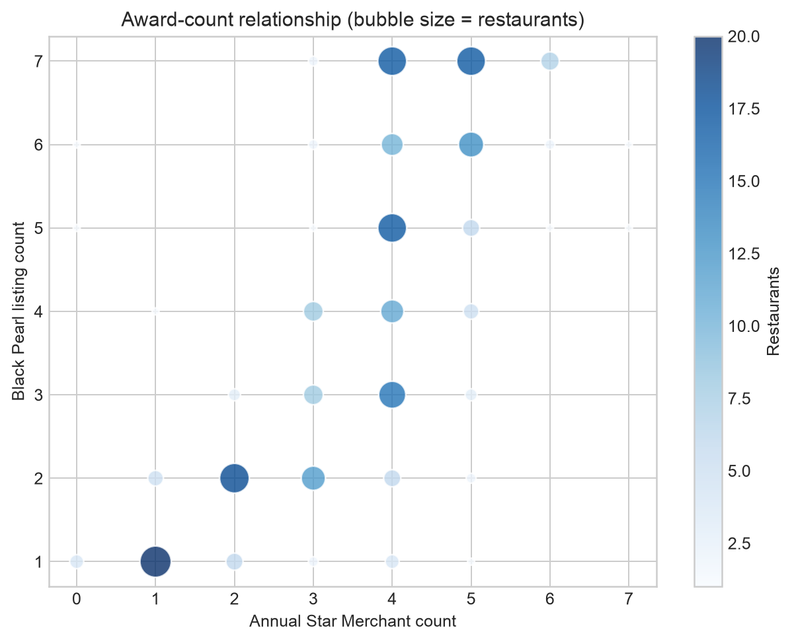
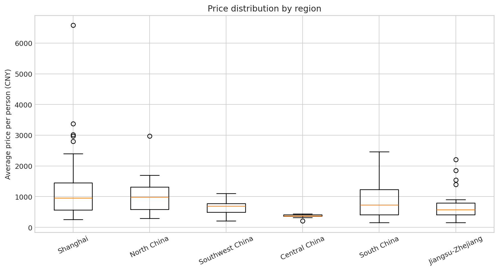

# Black Pearl Restaurant Analysis

Python replication and methodological audit of a 2024 research report on public platform ratings for restaurants listed in the China Black Pearl Restaurant Guide.

[中文说明](README_CN.md)

## Project scope

The source workbook contains 233 restaurants across six regions. This project:

- reproduces the paper's descriptive statistics and main OLS equation;
- reconciles an earlier 153-row workbook output with the final 233-row paper;
- distinguishes unstandardized slopes from standardized coefficients;
- adds HC3 robust inference, VIF, residual, and influence diagnostics;
- re-runs award-count, cuisine-region, regional-price, and diamond-level analyses;
- records data-quality issues instead of silently deleting observations.

The analysis concerns public consumer ratings for restaurants that appear in the guide. It does not recover the confidential Black Pearl jury selection algorithm.

## Main replication result

Using all 233 restaurants:

$$
\widehat{TotalScore}=0.1817+0.6174(Taste)+0.1963(Environment)+0.1436(Service)
$$

- $R^2=0.8925$; adjusted $R^2=0.8911$.
- Standardized coefficients are 0.676 for taste, 0.189 for environment, and 0.151 for service.
- VIF values range from 2.54 to 4.38.
- Under classical OLS inference, all three rating components are significant.
- With HC3 robust standard errors, taste and environment remain significant; service is borderline at $p=0.051$.


## Reconciliation with the original report

The old regression-output worksheet used the first 153 observations and produced $R^2=0.8673$. The equation printed in the paper comes from the expanded 233-row dataset and is reproducible to rounding precision.

The paper described 0.617, 0.196, and 0.144 as standardized coefficients. They are unstandardized slopes. The notebook reports both versions separately.

## Other findings

### Award counts

- Paired Wilcoxon statistic: 4,438; $p=1.51\times10^{-5}$.
- Spearman correlation: $\rho=0.709$.
- Paired Cohen's $d_z=-0.295$.
- The paper's magnitude of 0.246 is reproducible only with an independent-samples pooled standard deviation, which is not the appropriate paired effect-size definition.



### Cuisine and region

- Cramér's V is 0.616, reproducing the paper.
- 97.1% of expected contingency-table cells are below five, so the ordinary asymptotic chi-square p-value is unreliable on its own.
- A fixed-seed 5,000-permutation test gives $p=0.0002$.
- Cuisine labels are partly geographical by construction, so the association is not evidence of causality.

### Price and diamond level

- Regional price differences are significant under Kruskal-Wallis testing ($p<0.001$); Holm-adjusted pairwise results are included.
- The diamond groups contain 198 one-diamond, 30 two-diamond, and five three-diamond restaurants.
- A simple one-way ANOVA of public total score by diamond level gives $p=0.846$, not the 0.489 value stated in the report. The earlier mixed-model specification was not preserved, so it cannot be reconstructed exactly.



## Data-quality notes

- One restaurant has a missing cuisine label.
- Six records belong to three duplicated city-name keys and require manual review.
- The source `hello` column is exactly favourites divided by 1,000; it is renamed `favourites_thousands` and retained for provenance.
- The original narrative mentions ridge regression and questionnaire validation, but neither supporting output nor questionnaire data is present in the supplied files.

## Repository structure

```text
data/raw/                  Original workbook
data/processed/            Clean, analysis-ready CSV
figures/                   Reproducible charts
notebooks/                 Portfolio notebook with saved results
paper/                     Original research report
results/                   Statistical tables and audit outputs
src/analysis.py            End-to-end reproduction script
DATA_DICTIONARY.md         Variable definitions
METHODOLOGY.md             Statistical decisions and limitations
```

## Run the analysis

```bash
python -m venv .venv
source .venv/bin/activate        # Windows: .venv\Scripts\activate
pip install -r requirements.txt
python src/analysis.py
```

The script rebuilds the cleaned CSV, all result tables, all figures, and the notebook from the original workbook. Randomized analysis uses a fixed seed.

## Recommended portfolio wording

> Reproduced and audited a 233-restaurant study using Python, reconciling two historical sample versions and rebuilding OLS, non-parametric tests, effect sizes, diagnostics, and regional comparisons. Identified coefficient-labeling, sparse-table, and paired-effect-size issues and converted the original paper into an auditable analysis pipeline.

