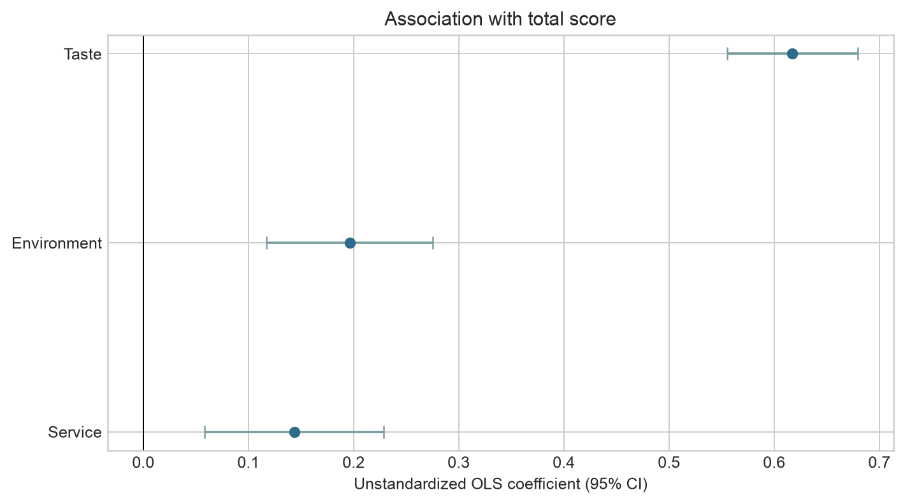

# Black Pearl Restaurant Data Analysis

Python analysis of 233 Black Pearl-listed restaurants using restaurant information and public rating fields manually compiled from Dianping/Meituan pages.

[中文说明](README_CN.md)

The dataset was compiled and analyzed before the final report was written. This repository follows that project sequence: data, analysis, results and report.

Final report: [`report/black_pearl_restaurant_analysis_report.pdf`](report/black_pearl_restaurant_analysis_report.pdf)

## Download the dataset

| File | Purpose |
|---|---|
| [`data/public/black_pearl_restaurants.csv`](data/public/black_pearl_restaurants.csv) | Canonical, analysis-ready table; best for Python/R/SQL |
| [`data/public/black_pearl_restaurants.xlsx`](data/public/black_pearl_restaurants.xlsx) | Formatted one-sheet version for Excel |
| [`data/raw/black_pearl_2024.xlsx`](data/raw/black_pearl_2024.xlsx) | Preserved source workbook, including historical Excel output sheets |

The public table has one restaurant per row, stable IDs, normalized Chinese/English geography, preserved source labels and split cuisine fields. The unnamed ingredient notes are converted to a numeric score; the redundant `hello` column is omitted because it equals `favourites_count / 1,000`.

See [`DATASET_CARD.md`](DATASET_CARD.md) for provenance, coverage and usage cautions, and [`DATA_DICTIONARY.md`](DATA_DICTIONARY.md) for field definitions.

## Selected findings

For the OLS model of public total score from taste, environment and service scores:

$$
\widehat{TotalScore}=0.1817+0.6174(Taste)+0.1963(Environment)+0.1436(Service)
$$

- $R^2=0.8925$; adjusted $R^2=0.8911$.
- Standardized coefficients are 0.676 for taste, 0.189 for environment and 0.151 for service.
- Under HC3 robust inference, taste and environment remain significant; service is borderline ($p=0.051$).
- VIF values range from 2.54 to 4.38.



- Award counts are paired within restaurants: Wilcoxon $p=1.51\times10^{-5}$ and Spearman $\rho=0.709$.
- Cuisine and region have Cramér's V=0.616, but 97.1% of expected cells are below five. A fixed-seed permutation test had zero exceedances in 5,000 draws, so $1/5001$ is a Monte Carlo resolution bound rather than an exact p-value.
- Regional price distributions differ under Kruskal–Wallis testing ($p<0.001$); Holm-adjusted pairwise results are included.
- Diamond levels are highly imbalanced: 198 one-diamond, 30 two-diamond and five three-diamond restaurants.

These are associations within a manually collected sample. They do not identify causal effects or reveal the confidential Black Pearl selection algorithm.

## Data-quality notes

- One restaurant has a missing cuisine label.
- Three city-and-name keys are duplicated and retained for review rather than silently removed.
- The source city field contains `江西 Jiangxi`, which is a province-level label, for two records. It is preserved and documented.
- Exact collection dates and per-record source URLs were not retained. No dates or URLs have been inferred.

## Repository structure

```text
data/raw/                  Preserved source workbook
data/processed/            Internal cleaned analysis table
data/public/               Standalone CSV and Excel dataset
figures/                   Generated charts
notebooks/                 Runnable analysis notebook
results/                   Statistical tables and quality checks
report/                    Final report written after the analysis
src/analysis.py            End-to-end analysis pipeline
tests/                     Validation tests
DATASET_CARD.md             Provenance and responsible-use notes
DATA_DICTIONARY.md          Field definitions
METHODOLOGY.md              Statistical decisions and limitations
```

## Run the analysis

Python 3.12 is recommended.

```bash
python -m venv .venv
source .venv/bin/activate        # Windows: .venv\Scripts\activate
pip install -r requirements.txt
python src/analysis.py
python -m unittest discover -s tests -v
```

The Python script rebuilds the public CSV, result tables, figures and output-free notebook. The Excel file is a formatted copy of the canonical public CSV.
